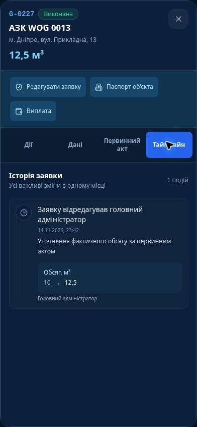

# Chief administrator order corrections

The order card has **Редагувати заявку** only when the authenticated server returns the explicit `applications.edit_any_stage` capability. Today this capability belongs exclusively to active `admin_users.role = owner`. No new employee permissions or owner accounts are created. Future employee grants should be introduced through this capability boundary, not by treating every ordinary administrator as an owner.

The editor works on new, assigned, in-progress, completed and cancelled orders. Editable data: existing canonical passport, description, contractor, schedule/deadline, actual cubic metres, existing result date, manager comment, unit price and agreed payout. The editor preserves the workflow status. Normal execution/review/payment actions remain separate. A recorded payment's recipient, price, amount, payment status and timestamp remain immutable; the owner can correct the actual work volume and other nonpayment data on a paid order.

## Authorization and consistency

- `office()` verifies the bearer token with Auth and reads the current active office role. `office.permissions`, `office.order_edit` and `office.order_edit_save` use a fresh database capability check. No client-supplied actor, role, user metadata or visible button is trusted.
- `rpv_owner_order_edit` is service-role-only, security invoker, with an empty search path. It locks the current active owner role, the application, submitted acts, service report, publication and work history. The snapshot checksum detects changes in the order or its result after the editor was opened. A retry key prevents duplicate corrections; changed retry payloads are rejected.
- Only allowlisted fields are accepted. Site identity comes from an existing, unmerged passport. Positive entered cubic metres remain mandatory when correcting volume. Neither status nor paid state can be supplied through this endpoint.
- The same transaction updates structured act data, the current service report, published RPV volume/site/date, and work history. Finance triggers update unpaid debt and record the actor. Originals of uploaded documents are retained. A correction does not rewrite a scanned document or forge a new signature.
- `rpv_order_revisions` stores full before/after snapshots, actor, reason and timestamp. RLS is enabled; anon/authenticated have no access; service_role can only select/insert. Application timeline entries expose readable changed values and the reason. Audit rows prevent deletion of their application.
- Submitted report mutation and paid-volume correction are allowed only within this verified owner transaction. Ordinary direct browser edits cannot bypass the editor to change order identity/text or closed work data. Ordinary role creation/management is unchanged.

## Validation

`tests/owner-edit.test.mjs` exercises every order stage, all office roles and inactive owners, direct browser denial, forged actor/context, a role revoked after reading, invalid volumes, stale order/result snapshots, idempotent retries, atomic rollback, immutable audit privileges, pending-act state retention, closed publication/history/debt reconciliation and paid-volume correction without changing the payment. The full portal suite runs its PGlite workers with concurrency 2 to bound memory use.

Browser QA uses synthetic orders only: 390px closed-order edit from 10 to 12.5 m³ with timeline history, hidden action for ordinary admin, locked paid recipient/amount, and retry after a simulated save failure. No live orders, acts, payments or notifications are created by QA.

